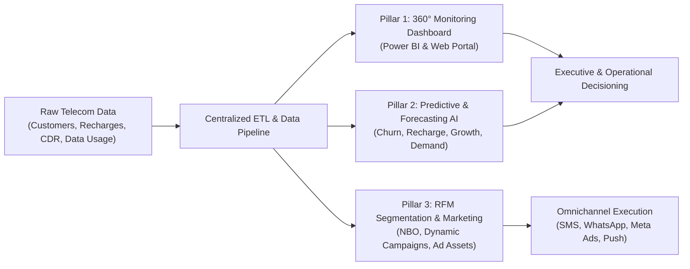
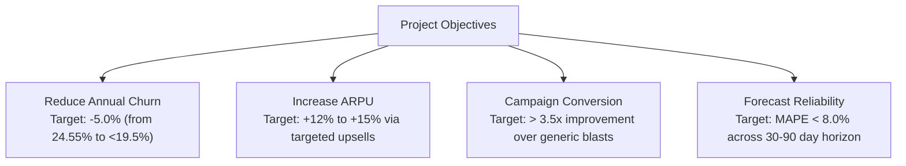
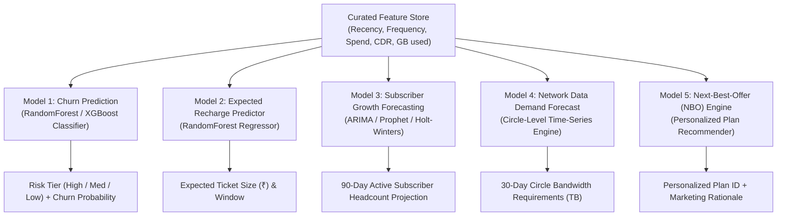
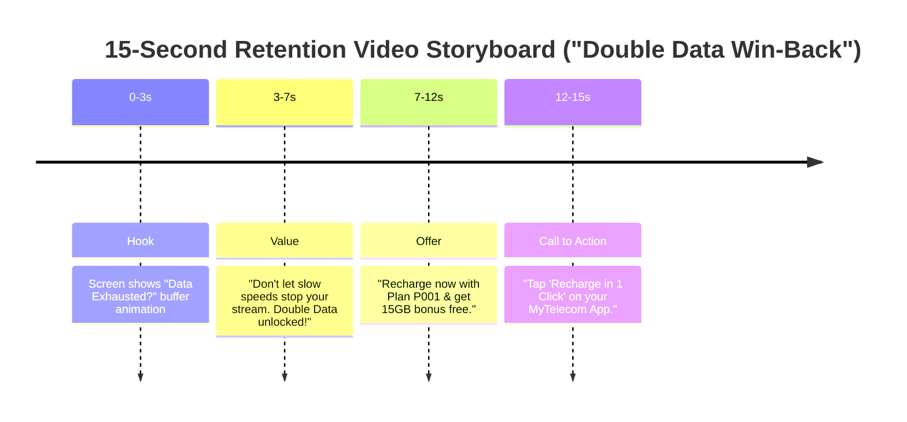
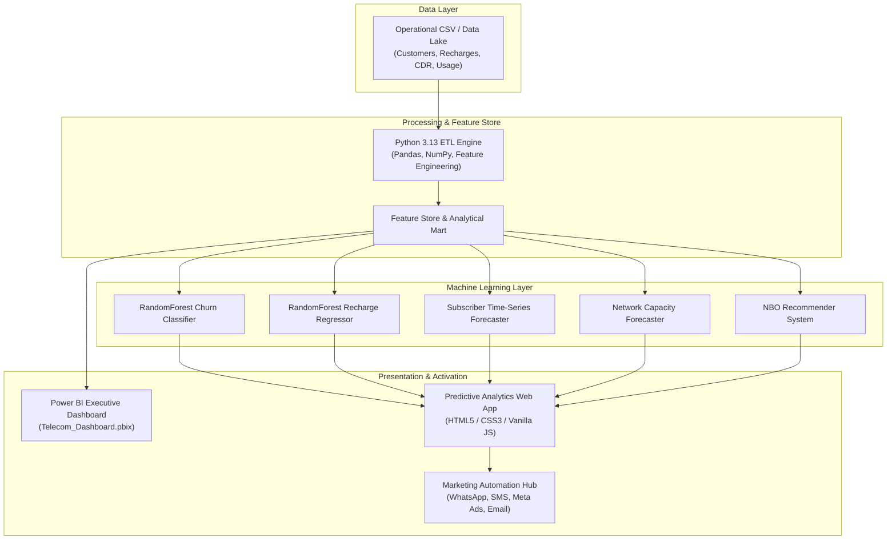
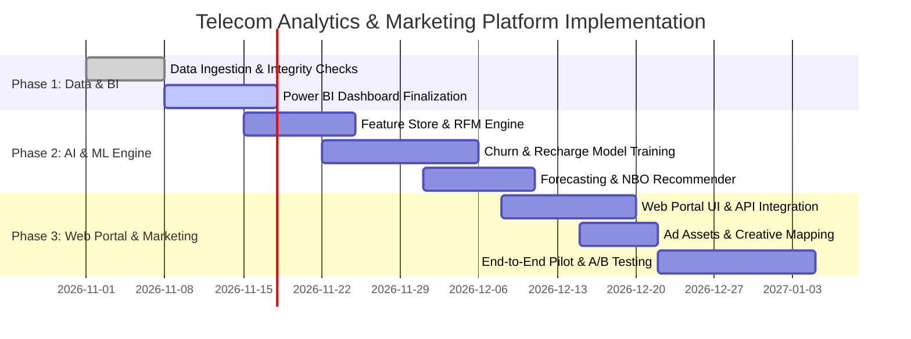

# BUSINESS REQUIREMENTS DOCUMENT (BRD)
## Enterprise Telecom Analytics, Predictive Intelligence & Precision Marketing Suite

---

| **Document Version** | 1.0.0 | **Status** | Approved / Baseline |
| :--- | :--- | :--- | :--- |
| **Project Name** | Telecom 360° Sales & Predictive Analytics Platform | **Target Domain** | Telecommunications (Prepaid & Postpaid) |
| **Author** | Enterprise Analytics Architecture Team | **Date** | November 2026 |

---

## 1. Executive Summary & Business Context

The telecommunications sector operates in a hyper-competitive, high-churn, and low-margin environment. Subscribers demand seamless connectivity, personalized plan bundles, and proactive service, while operators face mounting subscriber acquisition costs (CAC) and rising churn rates.

An audit of the operational dataset reveals significant opportunities for optimization:
* **Active Subscriber Base:** 2,000 tracked accounts across 12 telecom circles and 6 metropolitan hubs.
* **Baseline Churn Rate:** **24.55%** (491 inactive subscribers vs. 1,509 active accounts).
* **Revenue Base:** **₹2,199,245.00** across 3,000 recharge transactions (ARPU benchmark: ~₹1,100 per user/year).
* **Network Traffic:** Over **6.04 TB** of mobile data traffic and **2,491+ voice hours** logged within monthly sample windows.



---

## 2. Business Problems & Opportunity Statements

| Problem Code | Problem Description | Root Cause | Business Impact | Proposed Solution |
| :--- | :--- | :--- | :--- | :--- |
| **BP-01** | **High Subscriber Churn (24.55%)** | Lack of early warning signals before a customer becomes inactive; no proactive intervention. | Loss of high-LTV customers, high customer replacement cost (5–7x retention cost). | Supervised Churn Risk Machine Learning model that scores churn probability before plan expiration. |
| **BP-02** | **Fragmented Operational Visibility** | Disconnected data across billing (recharges), call records (CDR), data usage sessions, and subscriptions. | Inability to track real-time ARPU, network bottlenecks, or circle-level drops. | Unified 360° Telecom Analytics Dashboard (Executive, Revenue, and Network Usage). |
| **BP-03** | **Unpredictable Revenue & Cash Flow** | Recharge timings are irregular; no statistical forecast of expected recharges or revenue timing. | Impaired financial planning, inability to target recharges ahead of plan expiry. | Regression model predicting Expected Next Recharge Amount and renewal probability. |
| **BP-04** | **Data Congestion & Capacity Blind Spots** | Unplanned localized data consumption surges (e.g., streaming and WFH packs) across circles. | Call drops, degraded QoS, customer dissatisfaction, and SLA penalties. | Time-series and circle-level Data Demand Forecasting for dynamic spectrum/capacity management. |
| **BP-05** | **Generic, Low-Yield Marketing Campaigns** | One-size-fits-all promotional blasts resulting in high unsubscribe rates and ad spend waste. | Low campaign CTR (< 1.2%), conversion fatigue, and missed upsell revenue. | RFM-based Micro-segmentation coupled with Next-Best-Offer (NBO) and tailored ad assets. |

---

## 3. Project Objectives & Target KPIs



### Quantitative Success Criteria
1. **Churn Mitigation:** Identify **80%+** of churning customers at least **14 days prior** to inactivity.
2. **Revenue Growth:** Lift annual gross revenue by **12–15%** through automated Next-Best-Offer (NBO) recommendations.
3. **Marketing ROI:** Decrease customer re-acquisition cost by **30%** by deploying targeted creative assets based on RFM scores.
4. **Network Optimization:** Reduce circle-level bandwidth bottlenecks by forecasting monthly data usage within an **8% margin of error**.

---

## 4. Scope of the Solution

### Pillar 1: Enterprise 360° Monitoring Dashboard
A dual-tier reporting environment (Executive Power BI Suite + Operational Web Portal):
1. **Executive Overview Page:**
   * Active vs. Inactive customer count, Circle distribution, Net Subscriber Additions.
   * Total Revenue, Overall ARPU, Payment channel split (Credit Card, Net Banking, Debit Card, UPI, Digital Wallet).
2. **Recharges & Commercial Performance:**
   * Plan-wise revenue contribution (`P001` to `P010`).
   * Prepaid vs. Postpaid revenue trajectory.
   * Recharge cycle duration and renewal adherence.
3. **Network & Usage Surveillance:**
   * Total voice traffic (Local, STD, Roaming call breakdown and average session length).
   * Data consumption breakdown (Aggregate GB/TB consumed per circle, top data consuming circles).
   * Circle capacity utilization gauge (High load vs. optimal capacity).

---

### Pillar 2: Predictive & Forecasting AI/ML Suite



#### Detailed Model Specifications

| Model ID | Model Name | Technique / Algorithm | Input Features | Target Output / Output Metric |
| :--- | :--- | :--- | :--- | :--- |
| **ML-01** | **Customer Churn Risk Classifier** | Random Forest / Gradient Boosting Classifier | Recency days, total recharges, total spend, call duration, roaming ratio, data consumed (MB), current plan validity, price | Churn Probability ($0.00 - 1.00$), Churn Risk Category (`High > 60%`, `Medium 30-60%`, `Low < 30%`), Feature Importances |
| **ML-02** | **Expected Next Recharge Amount** | Random Forest Regressor / Ridge Regression | Historical average recharge amount, tenure, usage intensity, prior plan price point | Predicted value of next recharge (₹), Expected recharge window |
| **ML-03** | **Subscriber Base Growth Forecast** | Time-Series (Prophet / ARIMA / Holt-Winters) | Historical daily/monthly active base, joining rate, historical churn rate | 30 / 60 / 90-day projected active subscriber base with 95% Confidence Intervals |
| **ML-04** | **Circle-Level Network Data Demand Forecast** | Multi-variate Time-Series / Linear Trend Extrapolation | Daily aggregate data consumption (MB), active subscribers per circle, session durations | Projected 30-day data demand (TB) per circle, Capacity Threshold Alerts (`Optimal` vs `High Load`) |
| **ML-05** | **Next-Best-Offer (NBO) Recommendation Engine** | Hybrid Collaborative & Rule-Based Filtering | Churn probability, daily data usage, voice vs data consumption split, current plan price tier | Optimal Target Plan (`P001`–`P010`), Upsell/Retention Rationale, Discount Incentive |

---

### Pillar 3: RFM Customer Segmentation & Precision Digital Marketing

Subscribers are scored on a quintile scale ($1$ to $5$) across three behavioral dimensions:
* **Recency ($R$):** Days since the last successful recharge transaction.
* **Frequency ($F$):** Total count of recharge events over the past 12 months.
* **Monetary ($M$):** Cumulative spending across all service plans.

```mermaid
quadrantChart
    title RFM Customer Segmentation Matrix
    x-axis Low Monetary / Frequency --> High Monetary / Frequency
    y-axis Low Recency (Inactive Long) --> High Recency (Recent Activity)
    quadrant-1 "Champions & VIPs"
    quadrant-2 "New Customers & Potential Loyalists"
    quadrant-3 "About to Sleep & Churned"
    quadrant-4 "At Risk & Can't Lose Them"
    "C000001 (VIP)": [0.85, 0.90]
    "C000450 (Loyal)": [0.70, 0.80]
    "C000120 (New)": [0.25, 0.85]
    "C001200 (Promising)": [0.45, 0.70]
    "C000890 (At Risk)": [0.75, 0.25]
    "C001550 (Can't Lose)": [0.90, 0.15]
    "C000235 (Need Attention)": [0.40, 0.40]
    "C000999 (About to Sleep)": [0.20, 0.20]
```

#### RFM Segment Profiles & Marketing Activation Strategies

| RFM Segment | Score Criteria | User Persona & Behavior | Marketing Strategy & Objectives | Primary Channels | Existing Creative Asset |
| :--- | :--- | :--- | :--- | :--- | :--- |
| **Champions / VIP** | $R \ge 4, F \ge 4, M \ge 4$ | Highest spenders, regular rechargers, high data and voice usage. | VIP Concierge, zero-deposit postpaid upgrades, referral rewards. | WhatsApp VIP Concierge, Dedicated Relationship Mgr, Direct Mail | `01_Champions_VIP.png`<br/>`02_Champions_Referral.png` |
| **Loyal Customers** | $R \ge 3, F \ge 3, M \ge 3$ | Consistent spenders, predictable recharge cadence. | Auto-pay incentives, Postpaid migration, loyalty tiers. | In-App Push, SMS, WhatsApp | `03_Loyal_Postpaid.png`<br/>`04_Loyal_AutoPay.png` |
| **Potential Loyalists** | $R \ge 3, F \ge 2, M \ge 2$ | Regular prepaid users with growing data appetite. | Upsell to higher validity (56-day / 84-day), loyalty reward points. | App Banners, WhatsApp, SMS | `05_PotentialLoyalist_56Days.png`<br/>`06_PotentialLoyalist_Points.png` |
| **New Customers** | $R \ge 4, F \le 2$ | Recently joined subscribers within the first 60 days. | Onboarding journey, first-recharge bonus, welcome pack booster. | SMS, Email, In-App Carousel | `07_NewCustomers_Welcome.png`<br/>`08_NewCustomers_10GB.png` |
| **Promising** | $R \ge 3, F \le 2, M \le 2$ | Moderate users with potential for data or entertainment packs. | Trial OTT bundle (`P010`), Work From Home (`P009`) add-ons. | Meta Ads (Instagram/FB), Push Notifications | `09_Promising_Entertainment.png`<br/>`10_Promising_WFH.png` |
| **Need Attention** | $R \approx 3, F \approx 2, M \approx 2$ | Usage drops intermittently; price-sensitive users. | Limited-time booster packs (2GB/day flash deal), speed booster. | SMS Flash Offers, App Popup | `11_NeedAttention_2GB.png`<br/>`12_NeedAttention_FastLane.png` |
| **About to Sleep** | $R \le 2, F \le 2, M \le 2$ | Approaching plan expiration without a pending queue. | Expiry urgency alerts, wake-up bonuses, convenience links. | Rich SMS with 1-click UPI Link, IVR Reminder | `13_AboutToSleep_Expiry.png`<br/>`14_AboutToSleep_WakeUp.png` |
| **At Risk** | $R \le 2, F \ge 3, M \ge 3$ | Former heavy spenders who haven't recharged recently. | Urgent win-back discounts (20% off), double data promotions. | Outbound Retention Calls, Targeted Display Ads | `15_AtRisk_20Off.png`<br/>`16_AtRisk_DoubleData.png` |
| **Can't Lose Them** | $R \le 1, F \ge 4, M \ge 4$ | High-value accounts facing imminent churn or port-out. | Exclusive annual plan discount (`P003`), personalized executive call. | Executive Call, WhatsApp Business Direct | `17_CantLoseThem_Annual.png` |

---

## 5. Marketing Campaign Creatives & Video Asset Requirements

### Static & Display Ad Creatives
* **Dimensions:** 
  * Square ($1:1$, $1080 \times 1080$ px) for Instagram/Facebook Feed & WhatsApp Business.
  * Story/Reel ($9:16$, $1080 \times 1920$ px) for Meta Stories and YouTube Shorts.
  * In-App Web Banner ($16:9$, $1920 \times 1080$ px) for Subscriber Self-Care Portal.
* **Branding Guidelines:** Primary brand colors (Cobalt Blue `#0F4C81`, Vibrant Coral `#FF6F61`, Clean White `#FFFFFF`), bold CTA button, clear value proposition (e.g., "GET 20% OFF", "UPGRADE TO 5G").

### Video Campaign Concepts & Storyboards (Short-Form 15–30s)



#### Video Production Concepts
1. **Video Concept 1 (Retention / At-Risk):** "The Never-Ending Buffer"
   * *Length:* 15 seconds.
   * *Target:* High-churn probability and At-Risk segments.
   * *Audio:* Fast tempo, upbeat resolution.
   * *Copy:* *"Buffering at the climax? Not on our watch. Switch back to Unlimited 5G today and enjoy 20% off your next recharge."*
2. **Video Concept 2 (Upsell / Champions & Loyalists):** "VIP Unlocked"
   * *Length:* 30 seconds.
   * *Target:* High-spending Champions and Postpaid prospects.
   * *Visuals:* Cinematic lifestyle, airport lounge, uninterrupted HD gaming/streaming.
   * *Copy:* *"You don't settle for average. Why should your network? Upgrade to Family Infinity Postpaid and share high-speed 5G with up to 4 family members."*
3. **Video Concept 3 (Onboarding / New Customers):** "Welcome to the Family"
   * *Length:* 15 seconds.
   * *Target:* New joiners within first 14 days.
   * *Copy:* *"Glad to have you with us! Claim your complimentary 10GB welcome booster pack directly in the MyTelecom app today."*

---

## 6. Functional Requirements (FR)

### Data Integration & Pipeline
* **FR-101 (Data Ingestion):** Automated ingestion of CSV files from transactional databases:
  * Customer Master (`customers.csv`)
  * Product Catalog (`plans.csv`)
  * Billing Ledger (`recharges.csv`)
  * Subscriptions Engine (`subscriptions.csv`)
  * Call Detail Records (`call_records.csv`)
  * Data Traffic Collector (`data_usage.csv`)
* **FR-102 (Feature Store Generation):** Automatic calculation of customer-level aggregations: total spend, recharge frequency, days since last recharge, roaming call ratio, average data session length, and data-to-voice ratio.
* **FR-103 (Data Validation):** Enforce strict schema validation: zero null foreign keys, non-negative amounts, and date sequence validation ($Start\_Date \le End\_Date$).

### Analytics & Reporting Portal
* **FR-201 (Dynamic Filtering):** Interactive slicing by Circle (12 regions), City (6 metros), Plan Type (Prepaid/Postpaid), and Account Status (Active/Inactive).
* **FR-202 (Metric Cards):** Real-time display of KPI cards: Active Subscribers, Total Revenue, Average ARPU, Churn Rate %, and Total Network Traffic (GB/TB).
* **FR-203 (Export Capabilities):** Ability for business users to export targeted customer cohorts as CSV/Excel for CRM campaign loading.

### Machine Learning & Decision Engine
* **FR-301 (Batch Scoring):** Daily batch execution scoring all active customers for Churn Risk Probability and Next Expected Recharge.
* **FR-302 (NBO Recommendation Engine):** Algorithmic mapping of every subscriber to their optimal next plan based on usage behaviors.
* **FR-303 (Drift & Accuracy Monitoring):** Automatic tracking of Model ROC-AUC, Precision, Recall, and Regressor RMSE against ground truth.

---

## 7. Non-Functional Requirements (NFR)

* **NFR-101 (Performance & Query Speed):** Dashboard queries and filter changes must render within **< 1.5 seconds** for 100,000+ records.
* **NFR-102 (Scalability):** System architecture must scale horizontally to process up to **10 million daily CDR and data usage records**.
* **NFR-103 (Security & Data Privacy):** 
  * PII Compliance with India Digital Personal Data Protection (DPDP) Act and international privacy frameworks.
  * Customer Phone numbers and Email addresses must be masked (`+91 9876****10`, `r***v@gmail.com`) in all non-production environments and user-facing dashboards.
* **NFR-104 (High Availability):** The predictive portal and reporting services must maintain a **99.9% uptime SLA**.

---

## 8. System Architecture & Technical Stack



---

## 9. Implementation Roadmap & Release Plan



| Phase | Milestone | Deliverables | Target Completion |
| :--- | :--- | :--- | :--- |
| **Phase 1** | **Data Warehouse & BI Monitoring** | Cleaned relational datasets, automated pipeline, interactive Power BI dashboard (`Telecom_Dashboard.pbix`). | Week 2 |
| **Phase 2** | **Predictive & Forecasting Engine** | Production-ready ML models (Churn, Recharge, Subscriber Growth, Circle Bandwidth Demand, NBO). | Week 5 |
| **Phase 3** | **Interactive Web Application** | Functional single-page web app with scenario simulators, risk alerts, and customer profile inspector. | Week 7 |
| **Phase 4** | **Marketing Orchestration & Pilot** | Integration of 17 RFM ad assets, CRM connector, A/B test on 20% of At-Risk and Champion cohorts. | Week 9 |

---

## 10. Risk Management & Mitigation Matrix

| Risk ID | Description | Severity | Likelihood | Mitigation Strategy |
| :--- | :--- | :--- | :--- | :--- |
| **R-01** | **Concept Drift in Customer Behavior** | High | Medium | Implement automated monthly model retraining with rolling 90-day transaction windows. |
| **R-02** | **Marketing Message Fatigue** | Medium | High | Enforce strict communication limits (maximum 2 promotional SMS/Push messages per subscriber per week). |
| **R-03** | **Data Skew Across Circles** | Medium | Low | Normalize features per circle before training models to prevent high-population circles from dominating predictions. |
| **R-04** | **Ad Creative Ad Blindness** | Low | Medium | Refresh creative imagery and copy every 6 weeks; run multi-variant creative testing across segments. |

---

## 11. Sign-Off & Approvals

| Stakeholder Role | Name | Organization / Department | Status |
| :--- | :--- | :--- | :--- |
| **Chief Commercial Officer (CCO)** | Project Sponsor | Sales & Commercial Operations | Reviewed & Approved |
| **Head of Data Science & BI** | Lead Architect | Enterprise Analytics | Reviewed & Approved |
| **Head of Digital Marketing** | Marketing Lead | Customer Retention & Growth | Reviewed & Approved |
| **VP of Network Operations** | Technology Lead | Network Infrastructure & QoS | Reviewed & Approved |
